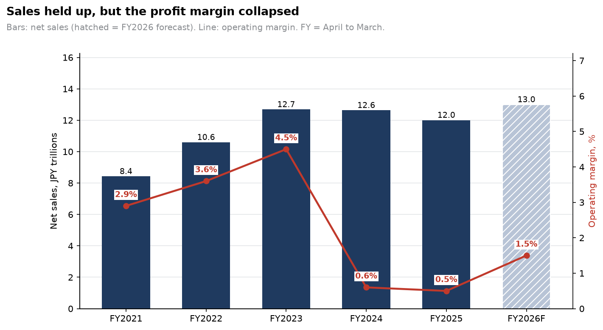
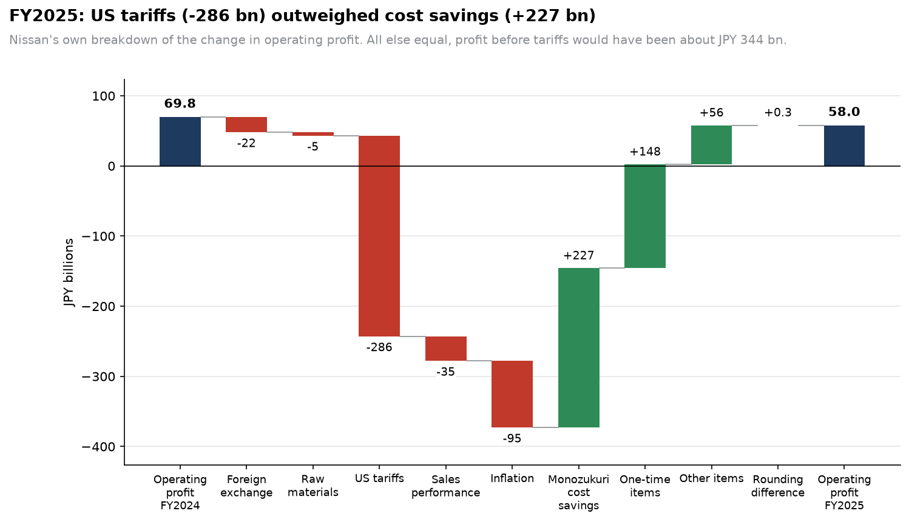
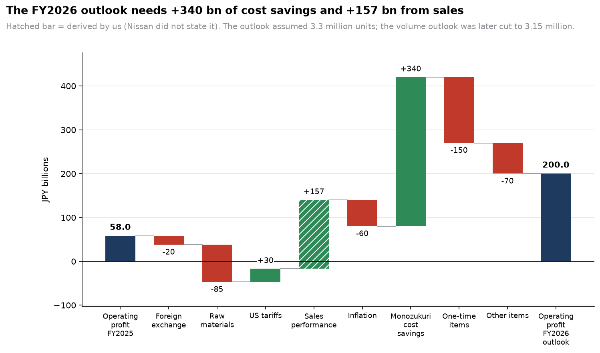
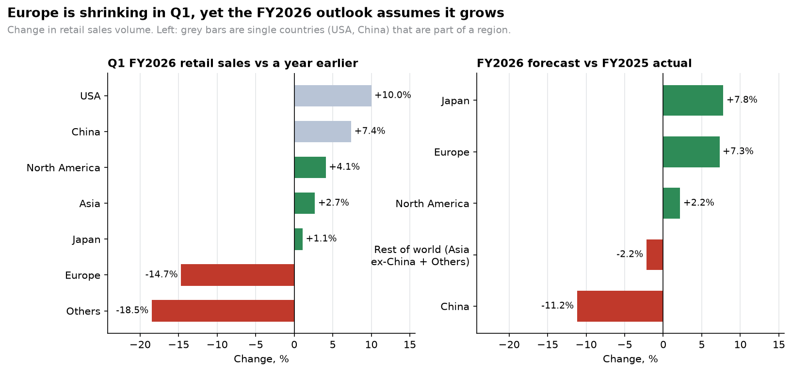

# Nissan Turnaround 2027: A Data-Driven Recovery Case Study

> An end-to-end analysis of Nissan Motor Co.'s current financial and operational
> challenges, with quantified recommendations for FY2026-FY2027.


## 1. Business Problem

Nissan is executing **Re:Nissan**, a restructuring plan built around roughly
¥500 billion in cost savings, about 20,000 job cuts and a smaller manufacturing
footprint, with the goal of returning to operating profit in FY2026
(April 2026 - March 2027). Early results are encouraging but mixed: North
America is recovering while Europe and China remain weak.

**Core question:** Where does Nissan make and lose money, why, and which
concrete moves would make the recovery durable in 2027 rather than driven by
one-off gains?

## 2. Deliverables

| Deliverable                 | Location     |
| --------------------------- | ------------ |
| SQL analysis scripts        | `/sql`       |
| Python notebooks            | `/notebooks` |
| Excel scenario model        | `/excel`     |
| Power BI dashboard          | `/powerbi`   |
| Executive report and slides | `/reports`   |

## 3. Tech Stack

Python (pandas, matplotlib, seaborn) - SQL (SQLite) - Excel - Power BI - Git/GitHub

## 4. Repository Structure

```text
nissan-turnaround-2027/
├── data/
│   ├── raw/            # Source data exactly as collected
│   └── processed/      # Cleaned data and the SQLite database
├── sql/                # Numbered, commented SQL scripts
├── notebooks/          # Exploratory and statistical analysis
├── src/                # Reusable Python modules and scripts
├── excel/              # Scenario model workbook
├── powerbi/            # Dashboard file and exports
├── reports/            # Executive report, slides, figures
├── docs/               # Data dictionary, methodology, glossary
├── requirements.txt
└── README.md
```

## 5. How to Reproduce

```bash
git clone https://github.com/Balkis Slama/nissan-turnaround-2027.git
cd nissan-turnaround-2027
python -m venv .venv
source .venv/bin/activate        # Windows PowerShell: .venv\Scripts\Activate.ps1
pip install -r requirements.txt
python src/check_setup.py
```

## 6. Data Sources

Full details, links and limitations: [`docs/data_sources.md`](docs/data_sources.md).
Column definitions: [`docs/data_dictionary.md`](docs/data_dictionary.md).

| Source                                          | Used for                                                                               |
| ----------------------------------------------- | -------------------------------------------------------------------------------------- |
| Nissan Investor Relations and Securities Report | Financials FY2021-FY2025, regional results, volumes, FY2026 outlook, Re:Nissan targets |
| Yahoo Finance                                   | Daily share prices of Nissan, Toyota, Honda, Mazda, Subaru                             |
| FRED (St. Louis Fed)                            | USD/JPY exchange rate                                                                  |
| Our World in Data / IEA                         | Electric car sales by country                                                          |

> **Note on fiscal years:** Nissan's FY2025 = April 2025 - March 2026.

### Raw data quality

Hand-collected figures are verified by an automated script
(`python src/validate_raw_data.py`) that checks structure, duplicates, source
references, whether regional figures add up to group totals, and whether
computed margins match Nissan's published margins.

## 7. Data Model

The analysis runs on a **star schema** in SQLite: 7 fact tables (financials,
regional results, volumes, restructuring targets, share prices, FX, EV sales)
around 5 dimensions (period, geography, company, date, source). The database
enforces data quality itself through primary keys, foreign keys and CHECK
rules, covered by 37 automated tests.

Diagram, table grains and design decisions: [`docs/data_model.md`](docs/data_model.md).

## 8. ETL Pipeline

One command rebuilds the whole database from the raw files and proves it is
correct:

```powershell
python src/run_etl.py
```

It builds the empty database, loads the dimensions, Nissan's results and the
market data, then runs 45 checks, including a "round trip" that compares every
stored value with the raw files and an independent second cleaning of the
market data. Cleaning rules (for example dropping exchange-holiday share price
rows) are documented in [`docs/etl_notes.md`](docs/etl_notes.md).

## 9. SQL Analysis

17 documented SQL queries (`sql/02_*.sql` to `sql/06_*.sql`) answer the
project's business questions: profitability and cash, regional profit, volumes,
Re:Nissan progress and market context.

```powershell
python src/run_sql_analysis.py     # runs all queries, saves tables to reports/tables/
python src/check_sql_analysis.py   # 22 checks: every answer recalculated independently with pandas
```

Query catalogue and findings: [`docs/sql_analysis.md`](docs/sql_analysis.md).

## 10. Charts and Nissan's Official Profit Bridge

```powershell
python src/validate_bridge_data.py   # 14 checks on Nissan's profit bridge data
python src/make_charts.py            # draws 8 charts into reports/figures/
python src/check_charts.py           # 18 checks: numbers, closing waterfalls, image sanity
```









### Findings so far (preliminary)

- **Profit collapsed while sales barely moved:** operating margin fell from
  4.5% (FY2023) to 0.5% (FY2025) although sales fell only 5%.
- **US tariffs (-286 bn yen) outweighed all of Nissan's cost savings (+227 bn yen)
  in FY2025**, according to Nissan's own breakdown. Even without tariffs the
  margin would have been about 2.9%, below FY2023's 4.5%, so tariffs are not
  the whole story: inflation (-95) and weaker sales performance (-35) also hurt.
- **The FY2026 outlook (200 bn yen) relies on +340 bn yen of cost savings and a
  derived +157 bn yen from sales performance**, but the volume outlook was cut
  from 3.3 to 3.15 million cars while the profit target was kept.
- **Europe loses money in every period; North America earns the most**, and
  about 96% of the Q1 FY2026 profit improvement comes from North America,
  where Nissan itself reports one-time tariff-related gains.
- **The FY2026 outlook assumes a European volume recovery (+7.3%)** although
  European retail fell 14.7% in Q1: a key assumption to stress-test.
- Much of the Q1 rise in revenue per vehicle (+15.6%) mirrors the weaker yen
  (USD/JPY +10.3%).

Details and caveats: [`docs/profit_bridge.md`](docs/profit_bridge.md).

## 11. Quality Assurance

Every layer is tested, and answers are always recalculated with a second,
independent method:

| Layer              | Command                              | Checks |
| ------------------ | ------------------------------------ | ------ |
| Raw data           | `python src/validate_raw_data.py`    | 37     |
| Database rules     | `python src/test_schema.py`          | 37     |
| ETL pipeline       | `python src/run_etl.py`              | 45     |
| SQL analysis       | `python src/check_sql_analysis.py`   | 22     |
| Profit bridge data | `python src/validate_bridge_data.py` | 14     |
| Charts             | `python src/check_charts.py`         | 18     |

In total the project runs **173 automated checks**.

## 12. Project Progress

- [x] Step 1: Environment and repository setup
- [x] Step 2: Data acquisition and validation
- [x] Step 3: Data model (SQL star schema)
- [x] Step 4: ETL and cleaning (one-command pipeline)
- [x] Step 5: SQL analysis (17 queries, independently verified)
- [ ] Step 6: Python analysis (part 1 done: official profit bridge and 8 charts; part 2: market statistics and EV markets)
- [ ] Steps 7-10: Break-even model, scenario model, recommendations
- [ ] Step 11: Power BI dashboard
- [ ] Step 12-14: Report, slides, final polish

## 13. Key Findings

_To be completed at the end of the project._

## 14. Author

**<Your Name>**: Software Engineer, AI/ML Engineer and Data Scientist
[LinkedIn](https://www.linkedin.com/in/your-profile) - [GitHub](https://github.com/your-username)
