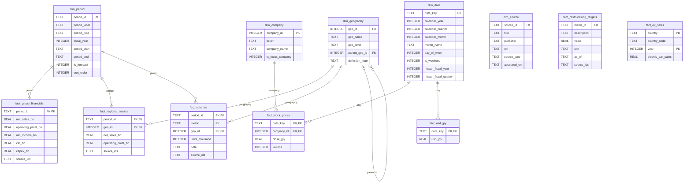

# Data Model

The analytical database (`data/processed/nissan.db`, SQLite) is a **star
schema**: fact tables hold measurements, dimension tables hold the context
(period, geography, company, date, source). It is built by
`sql/01_create_schema.sql` via `python src/create_database.py` and its rules
are tested by `python src/test_schema.py`.

## Entity-relationship diagram

Only the main columns are drawn for the fact tables; the full list is in
`sql/01_create_schema.sql`.

## Grain of each table

| Table                      | One row represents                                                  |
| -------------------------- | ------------------------------------------------------------------- |
| dim_period                 | one reporting period (fiscal year, first quarter, or forecast)      |
| dim_geography              | one geographic unit (total, region, country, segment or adjustment) |
| dim_company                | one listed company whose share price is tracked                     |
| dim_date                   | one calendar day, with Nissan fiscal year attached                  |
| dim_source                 | one source document                                                 |
| fact_group_financials      | one period (group level)                                            |
| fact_regional_results      | one period x region (incl. eliminations)                            |
| fact_volumes               | one period x metric x geography                                     |
| fact_restructuring_targets | one Re:Nissan target or progress marker                             |
| fact_stock_prices          | one trading day x company                                           |
| fact_usd_jpy               | one business day                                                    |
| fact_ev_sales              | one country (or aggregate) x year                                   |

## Design decisions

1. **Nissan fiscal year in `dim_date`.** FY2025 = April 2025 to March 2026, so
   daily prices and FX rates can be grouped by Nissan fiscal period.
2. **Conformed geography dimension.** One `dim_geography` serves both regional
   results and volumes; `parent_geo_id` rolls countries (USA, China) up to
   regions without double counting.
3. **Missing values are NULL, never 0.** "Not published" is different from
   "zero".
4. **Sources kept as a text list** (`source_ids`, separated by `;`) instead of
   a bridge table. Simpler for this project; a load-time check verifies that
   each code exists in `dim_source`.
5. **`fact_ev_sales` is stand-alone.** It uses country-level global data, a
   different taxonomy from Nissan's regions.
6. **Constraints enforce quality inside the database** (primary keys, foreign
   keys, CHECK rules, NOT NULL). SQLite needs `PRAGMA foreign_keys = ON` on
   every connection, which all project scripts set.

## Naming conventions

- `dim_` / `fact_` prefixes, snake_case.
- Money columns end in `_bn` (JPY billions); volumes in thousand units.
- Dates are ISO text (`YYYY-MM-DD`).
